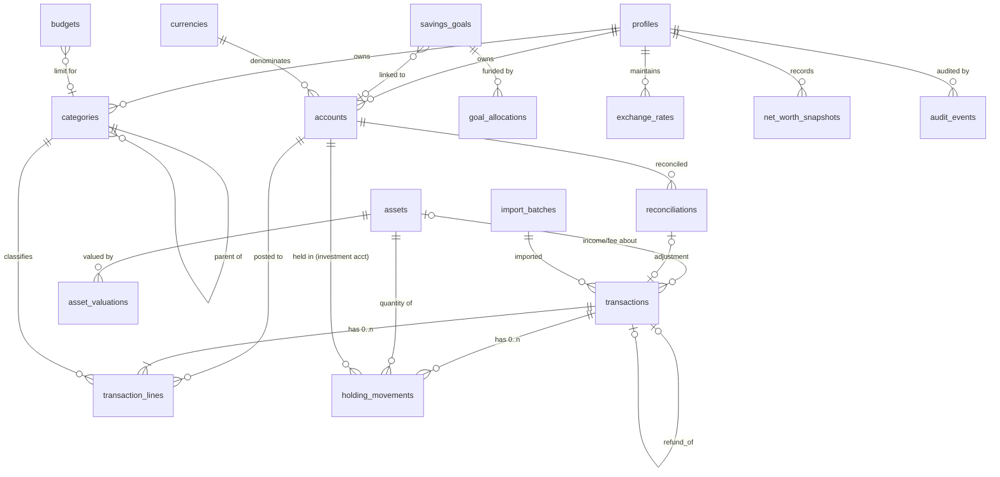

# 3. Data model and migrations

## 3.1 Ownership model

- Every user-owned table has `user_id uuid not null references auth.users(id) on delete cascade`, defaulting to `auth.uid()`.
- Every user-owned table has RLS **enabled and forced**, with four policies (select, insert, update, delete), each `using (user_id = (select auth.uid()))` / `with check (user_id = (select auth.uid()))`. Append-only tables (audit events, snapshots) have no update policy.
- **Cross-user references are impossible at the schema level.** Child tables reference their parent through a **composite foreign key `(parent_id, user_id)`** that points to a `unique (id, user_id)` on the parent. A line therefore cannot point at another user's account even if RLS were misconfigured.
- `anon` has no privileges on any table. `authenticated` gets only the table privileges the policies need. The service role is used only server-side, for deleting the auth user.

## 3.2 Entity diagram

## 3.3 Numeric types

| Purpose                   | Type             | Notes                                                                                                                                         |
| ------------------------- | ---------------- | --------------------------------------------------------------------------------------------------------------------------------------------- |
| Money amounts             | `numeric(20,4)`  | 4 dp stored, so per-line FX conversion keeps sub-minor precision. User-entered amounts are validated to the currency's minor units (PKR = 2). |
| Quantities                | `numeric(28,10)` | Crypto (8 dp+), fractional fund units, grams of gold.                                                                                         |
| Unit prices               | `numeric(28,10)` |                                                                                                                                               |
| FX rates                  | `numeric(24,12)` |                                                                                                                                               |
| Dates of financial events | `date`           | A calendar date in the user's timezone (Asia/Karachi).                                                                                        |
| Audit and system times    | `timestamptz`    | Stored in UTC and displayed in Asia/Karachi.                                                                                                  |

## 3.4 Tables

Enum types are shown in _italics_. All tables have `created_at timestamptz default now()`. Mutable tables also have `updated_at`, maintained by a trigger.

### Reference

**`currencies`** (global, read-only to `authenticated`): `code char(3) pk`, `name`, `minor_units smallint` (e.g. PKR 2, USD 2, JPY 0, KWD 3). Seeded from ISO 4217.

### Profile

**`profiles`**: `user_id pk → auth.users`, `display_name`, `base_currency char(3) default 'PKR' → currencies`, `timezone text default 'Asia/Karachi'`, `theme` (_system|light|dark_). A trigger on `auth.users` insert creates the profile and default categories.

### Accounts

**`accounts`**: `id uuid pk`, `user_id`, `name`, `type` (_cash, bank, digital_wallet, savings, investment, credit_card, loan, other_asset, other_liability_), `class` (_asset|liability_, a **generated** column derived from `type`), `currency → currencies`, `opening_balance numeric(20,4) default 0`, `opening_date date`, `institution text null` (a label only), `notes`, `status` (_active, closed, archived_), `include_in_net_worth bool default true`, `is_liquid bool` (defaults from type: cash, bank, wallet and savings are true).
Constraints: `unique (user_id, name)`, `unique (id, user_id)`. A trigger blocks changing `currency` once any line references the account. Accounts that have lines cannot be deleted (FK `restrict`); they are archived instead.

### Categories

**`categories`**: `id`, `user_id`, `name`, `kind` (_income|expense_), `parent_id null` (composite FK to `(id,user_id)`; at most 2 levels, enforced by trigger; the child's kind equals the parent's kind), `color`, `icon`, `is_archived`, `system_key text null` (for example `uncategorized_expense`, which cannot be deleted).
`unique nulls not distinct (user_id, parent_id, name)`. Categories that have lines can only be archived, or merged into another category through an RPC.

### Transactions (journal)

**`transactions`** (header): `id`, `user_id`, `kind` (_income, expense, refund, transfer, adjustment, opening_holding, buy, sell, dividend, interest, investment_fee, split_), `occurred_on date`, `description text`, `payee text null`, `notes`, `tags text[] default '{}'` (GIN index), `status` (_cleared|pending_), `refund_of_id null` (self composite FK), `asset_id null` (for dividend, interest, investment_fee and split), `import_batch_id null`, `import_fingerprint text null`, `reconciliation_id null` (set when the transaction is locked into a reconciliation).
Indexes: `(user_id, occurred_on desc, id)` for keyset pagination, `(user_id, import_fingerprint)`, trigram on `description` for search.

**`transaction_lines`**: `id`, `user_id`, `transaction_id` (composite FK, `on delete cascade`), `account_id` (composite FK `(account_id, user_id) → accounts(id, user_id)`), `amount numeric(20,4) not null check (amount <> 0)`, in the account's currency and **signed by net-worth effect** (see accounting rules), `category_id null` (composite FK), `memo`.
Index `(user_id, account_id)`, `(user_id, category_id)`.

**`holding_movements`**: `id`, `user_id`, `transaction_id` (cascade), `account_id` (must be an `investment`-type account; trigger check), `asset_id` (composite FK), `quantity numeric(28,10) not null check (quantity <> 0)` signed (+ in, − out), `unit_price numeric(28,10) null` (in the asset currency; required for buy and sell), `fee numeric(20,4) default 0 check (fee >= 0)` (in the asset currency), `cost_amount numeric(20,4) null` (only for `opening_holding`: the cost basis being brought in).

**Shape rules per kind.** These are enforced by the RPC and re-checked by a `deferrable initially deferred` constraint trigger at commit:

| kind                | lines                                                                  | holding movements                       | category                               |
| ------------------- | ---------------------------------------------------------------------- | --------------------------------------- | -------------------------------------- |
| income              | ≥1, all > 0, one account                                               | 0                                       | income category on every line          |
| expense             | ≥1, all < 0, one account                                               | 0                                       | expense category on every line         |
| refund              | ≥1, all > 0, one account                                               | 0                                       | expense category (it reduces spending) |
| transfer            | exactly 2, different accounts, opposite signs; same currency ⇒ sum = 0 | 0                                       | none                                   |
| adjustment          | exactly 1, either sign                                                 | 0                                       | none; `notes` required                 |
| opening_holding     | 0                                                                      | 1, qty > 0, `cost_amount` set           | none                                   |
| buy                 | 1 cash line < 0 (any asset-class account)                              | 1, qty > 0, unit_price set              | none                                   |
| sell                | 1 cash line > 0                                                        | 1, qty < 0, unit_price set              | none                                   |
| dividend / interest | 1 line > 0                                                             | 0                                       | none; `asset_id` required              |
| investment_fee      | 1 line < 0                                                             | 0                                       | none; `asset_id` optional              |
| split               | 0                                                                      | 1 per affected position, cost unchanged | none; `asset_id` required              |

Position invariant: after any write, the running quantity of every (account, asset) position, in date order, must never go below 0. The RPC checks this for every position the write touches, including later sales that an edit to an earlier buy could invalidate.

### Investments

**`assets`**: `id`, `user_id`, `name`, `symbol null`, `category` (_stock_etf, fund, gold, crypto, fixed_income, cash_like, custom_), `currency` (pricing currency), `quantity_scale smallint` (display and validation precision), `unit_label` (shares, units, grams, tola, coins…), `valuation_mode` (_manual | par_; `par` is allowed only for fixed_income and cash_like and values at 1 per unit, clearly labelled), `details jsonb default '{}'` (category-specific fields such as karat, maturity date, coupon rate or ISIN, validated by a per-category Zod schema), `price_source text default 'manual'` (a hook for future providers), `status`, `notes`. `unique (user_id, name)`.

**`asset_valuations`**: `id`, `user_id`, `asset_id`, `valued_on date`, `unit_price numeric(28,10) not null check (>= 0)`, `currency`, `entered_as` (_unit_price|total_value_), `entered_total numeric(20,4) null`, `quantity_at_entry numeric(28,10) null`, `source` (_manual|import|provider_), `source_note`. `unique (asset_id, valued_on, source)`. A total value entered by the user is converted to a unit price using the quantity held on `valued_on`, and the original input is kept for audit. Valuations are never overwritten; a correction is a new row or an audited edit.

### Planning

**`budgets`**: `id`, `user_id`, `month date check (extract(day from month)=1)`, `category_id null` (null = overall limit), `amount numeric(20,4) check (> 0)`, `currency` (= the profile's base currency at creation time). `unique nulls not distinct (user_id, month, category_id)`.

**`savings_goals`**: `id`, `user_id`, `name`, `description`, `target_amount`, `currency`, `target_date null`, `funding_mode` (_linked_account | allocations_), `linked_account_id null` (required if and only if mode = linked_account), `status` (_active, completed, archived_), `completed_on null`.

**`goal_allocations`**: `id`, `user_id`, `goal_id`, `allocated_on date`, `amount numeric(20,4)` (+ allocate, − release), `source_account_id null`, `note`. These are earmarks only. They are **not** ledger entries and do not change balances or net worth.

### Control and history

**`reconciliations`**: `id`, `user_id`, `account_id`, `statement_date`, `statement_balance`, `computed_cleared_balance`, `difference`, `adjustment_transaction_id null`, `note`. They are immutable once created; to undo one, delete it, which is audited.

**`exchange_rates`**: `id`, `user_id`, `base char(3)`, `quote char(3)`, `rate numeric(24,12) check (> 0)`, `effective_on date`, `source_note`. Meaning: **1 unit of `base` = `rate` units of `quote`**. `unique (user_id, base, quote, effective_on)`, `check (base <> quote)`.

**`net_worth_snapshots`**: `id`, `user_id`, `as_of date`, `base_currency`, `total_assets`, `total_liabilities`, `net_worth`, `method_version int`, `details jsonb` (per-account balances, per-position quantity, valuation used with its date, every FX rate used with its date, unvalued and unconvertible items). `unique (user_id, as_of)`. There is no update policy.

**`import_batches`**: `id`, `user_id`, `kind` (_transactions_csv | backup_restore_), `file_name`, `row_count`, `status`, `summary jsonb`. Deleting a batch through an RPC removes all of its transactions in one database transaction, so a whole import can be undone.

**`audit_events`**: `id bigint identity`, `user_id`, `table_name`, `record_id uuid`, `action` (_insert|update|delete_), `before jsonb`, `after jsonb`, `occurred_at timestamptz`, `txid bigint` (groups the rows written by one RPC). These rows are written by `SECURITY DEFINER` triggers on all financial tables. Users can select them; nobody can update them; deletion happens only by cascade when the account is deleted.

## 3.5 Database functions (RPCs)

All of these are `SECURITY INVOKER`, so RLS applies, with `set search_path = ''`. Each runs in one transaction and returns ids or text-encoded numbers.

| Function                                                                                     | Purpose                                                                                                              |
| -------------------------------------------------------------------------------------------- | -------------------------------------------------------------------------------------------------------------------- |
| `create_transaction(p jsonb)` / `update_transaction(id, p jsonb)` / `delete_transaction(id)` | Writes or replaces the header, lines and movements atomically, after shape, ownership, currency and position checks. |
| `import_transactions(batch jsonb)`                                                           | All-or-nothing CSV commit. It returns per-row errors and writes nothing if any row is invalid.                       |
| `undo_import(batch_id)`                                                                      | Removes a whole import batch.                                                                                        |
| `reconcile_account(p jsonb)`                                                                 | Marks lines cleared, stores the reconciliation, and creates an optional adjustment.                                  |
| `merge_category(from, into)`                                                                 | Moves lines to another category and archives the source.                                                             |
| `create_net_worth_snapshot(p jsonb)`                                                         | Stores a snapshot that the server computed with the domain code. The RPC only checks its shape.                      |
| `restore_backup(p jsonb)`                                                                    | Restores a full backup into an empty account, remapping ids. All-or-nothing.                                         |
| `delete_my_data()`                                                                           | Removes all of the user's rows. The auth user is then deleted by a server route that uses the service role.          |
| `aggregate_lines(from, to, group_by)`                                                        | Read-only plain sums by account, currency, category and month. Applies no policy.                                    |

## 3.6 Deletion, edit and reversal strategy

- **Edits:** allowed on any transaction. Because balances and gains are derived, there are no stored totals to correct. The audit trigger records the before and after images.
- **Deletes:** hard delete with cascade to lines and movements, recorded in `audit_events` with the full before image, so the record can be restored from the audit view.
- **Reconciled records:** a transaction linked to a reconciliation needs an explicit "unlock" confirmation before it can be edited or deleted. The reconciliation then shows "changed since reconciled".
- **Reversals:** for a real-world reversal (for example a bounced payment), the user records a refund, or the opposite transaction, linked with `refund_of_id`. The original is kept.
- **Accounts, categories and assets** that have history are archived, not deleted.

## 3.7 Migration plan

Migrations live in `supabase/migrations/` and are applied with `supabase db push` (or `psql` in CI). Nothing is ever changed by hand in the production SQL editor.

1. `0001_extensions_reference.sql`: `pgcrypto`, `pg_trgm`, enums, `currencies` seed.
2. `0002_profiles_accounts_categories.sql`: tables, composite keys, profile/default-category trigger, RLS.
3. `0003_ledger.sql`: `transactions`, `transaction_lines`, shape constraint trigger, RLS.
4. `0004_audit.sql`: `audit_events`, generic audit trigger attached to the financial tables.
5. `0005_ledger_rpcs.sql`: create, update, delete and import transaction functions, `aggregate_lines`.
6. `0006_reconciliation.sql`
7. `0007_budgets_goals.sql`
8. `0008_fx.sql`
9. `0009_investments.sql`: assets, valuations, holding movements, position invariant, investment RPC branches.
10. `0010_snapshots_backup.sql`: snapshots, import batches, restore, delete-my-data.

Every migration ships with SQL tests (RLS and invariants) in the same PR. Types are regenerated after each schema change.

## 3.8 Data that is deliberately _not_ stored

Running balances, cost basis, realized gains, budget actuals, goal progress and "current value" are always derived. The only stored results are snapshots, and they are dated, frozen records of a past calculation, not editable facts.

## 3.9 Backup, restore and recovery

- **CSV exports:** transactions, accounts, categories, assets, valuations, goals and allocations, budgets, exchange rates and every report.
- **JSON backup:** a versioned document (`format: "finance-track-backup", version: 1, exported_at, base_currency`) with all user tables and their ids, so the relationships are preserved.
- **Restore:** `restore_backup` loads into an empty account inside one transaction. It fails as a whole and names the bad records.
- **Recovery test:** an automated integration test exports, deletes, restores and checks that every derived figure (balances, positions, gains, net worth) is identical.
- **What Supabase Free does not provide** (verify at deploy time): point-in-time recovery or downloadable automated backups. **The user's own exported backup is the recovery mechanism.** The runbook (Phase 8) recommends exporting weekly and keeping copies on two devices.
